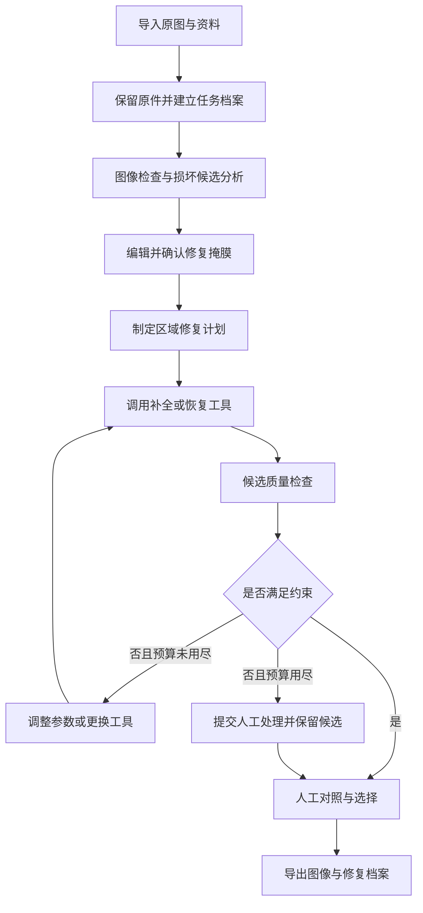

**壁画修复 Agent：GitHub 调研与完整制作流程**

调研日期：2026-10-31。默认目标：制作可在本地或单台 GPU 服务器上运行的壁画数字修复 Web 应用。首版面向裂缝、局部脱落和小范围缺损，随后扩展大面积补全与颜色辅助重建。

本次完成的是仓库与文档核查，没有安装依赖、下载权重或实测模型效果。下文将仓库已公开的信息与建议的工程方案分开说明；硬件、工期与数据规模为规划参考。

**一、调研结论与项目选型**

已有可以组合利用的壁画算法、图像修复 Agent 和交互式修复工具。本次核查的项目各有侧重，不能直接视为已经完成壁画诊断、证据检索、受控补全、人工复核和过程归档的整套产品。

建议首版采用“可编辑掩膜 + LaMa 补全 + 明确状态机 + 修复评估 + 版本档案”，先完成无需训练的闭环；随后引入 SAM 2、壁画专用模型、受约束扩散补全和知识检索。

| 项目与来源 | 已核查内容 | 在本项目中的用途 | 接入门槛与结论 |
|---|---|---|---|
| [CMAMRNet](https://github.com/CXH-Research/CMAMRNet) | BMVC 2025 壁画修复研究；有 models、train.py、test.py、配置文件；README 链接敦煌数据集；代码 MIT | 优先作为壁画专用对照模型，研究 mask 引导 | README 未见明确的预训练权重下载入口；需要进一步核对依赖、权重和真实图片推理。不能承诺开箱即用 |
| [PGRDiff](https://github.com/CZY-Code/PGRDiff) | 提示引导残差扩散壁画修复；有环境文件、训练和评估说明；README 提供 DUNHUANG、muralv2 与权重网盘链接 | 第二阶段研究候选，比较退化恢复与补全表现 | 权重链接存在不等于本次已下载验证；根目录/README 未见明确许可证，复用授权需确认；需核对其输入与当前 mask 补全接口是否一致 |
| [MuralXGAN](https://github.com/Mural-inpaint/MuralXGAN) | README 描述 BLIP-2 生成损坏描述、CLIP 文本引导、CNN/GAN 修复与颜色校正；含训练、测试与 requirements | 参考多模态诊断和颜色协调设计 | README 的效果与数据规模为作者陈述，本次未验证；根目录/README 未见明确许可证；权重和数据获取还需核对，适合参考而非首版依赖 |
| [Building Bridge Across the Time](https://github.com/Shaocr/Building-Bridge-Across-the-Time-Disruption-and-Restoration-of-Murals-In-the-Wild) | 有训练、测试脚本、数据与 checkpoint 获取说明；README 说明获取 Ground Truth 需联系作者并填表；作者实验环境使用 8 张 RTX 3090 | 真实壁画退化、数据组织和研究基线参考 | 数据门槛较高；作者训练环境不能作为本项目推理最低配置；本次未确认代码授权和权重可用性 |
| [AgenticIR](https://github.com/Kaiwen-Zhu/AgenticIR) | ICLR 2025 通用图像修复 Agent；包含探索学习、经验蒸馏、规划与推理流程；安装说明列出多个修复工具和 DepictQA | 最直接的 Agent 架构参考，借鉴选工具、评估、反馈与经验记录 | 主要展示去模糊、去雾、低照度等恢复；不能直接等同壁画缺损补全。原版工具栈和环境多，首版只借鉴流程；本次未确认完整授权链 |
| [LaMa](https://github.com/advimman/lama) | 通用图像补全；有预测、训练脚本和预训练权重获取说明；[代码许可证](https://github.com/advimman/lama/blob/main/LICENSE)为 Apache-2.0 | 首版默认补全后端，建立稳定基线 | 原始依赖较旧；README 提醒部分旧下载源失效，应使用当前说明中的来源；壁画适配效果需实测 |
| [IOPaint](https://github.com/Sanster/IOPaint) | 自托管修复 WebUI、LaMa/扩散模型、交互分割、批处理；代码 Apache-2.0 | 最快验证画笔、掩膜和修复效果，也可参考前后端交互 | GitHub 明确显示于 2025-08-13 归档，只读；适合锁版本原型，长期产品需维护自己的接口与依赖 |
| [SAM 2](https://github.com/facebookresearch/sam2) | 点/框提示分割、图像预测接口、SAM 2.1 权重及微调说明；主代码与模型 checkpoint 为 Apache-2.0，第三方部分另有许可 | 帮助用户圈选需要修复的区域 | 分割对象不等于识别病害；壁画裂纹、原画线条、底色之间可能混淆，仍需病害标签与人工修正 |
| [Diffusers](https://github.com/huggingface/diffusers) | Apache-2.0 的扩散模型推理和训练库；README 列出图像补全、ControlNet 与超分等管线 | 第二阶段接入补全、结构控制和 LoRA | 库的许可证不代表所有模型权重的许可证；模型与版本需要单独选择和测评 |

选择顺序：LaMa 做工程基线，CMAMRNet 做壁画领域对照，PGRDiff 做扩展研究，AgenticIR 提供流程设计参考，SAM 2 提供交互辅助。IOPaint 用于快速试验；Diffusers 在实际出现结构补全需求后接入。

**二、明确产品目标与交付范围**

输入：壁画图像、可选的损坏掩膜、可选的历史照片/临摹图/同题材参考、修复模式和资源预算。

输出：损坏标注、修复计划、候选结果、局部对照、修改区域图、质量检查、引用的参考证据、可复现的修复档案。

建议设置三种模式：

| 模式 | 适用情况 | 系统行为 |
|---|---|---|
| 保守修补 | 裂缝、针孔、小块脱落、重复底纹 | 优先局部纹理与边缘连续性；严格约束可修改区域 |
| 证据辅助重建 | 有同一壁画历史照片、线稿或可信临摹图 | 先配准参考图，再在证据支持的区域重建；记录来源和变换 |
| 推测性补全 | 缺失人物、器物或较大语义区域，缺乏直接证据 | 生成多种备选并标注推测区域，不将候选称为历史原貌 |

首版完成保守修补和候选管理即可。数字图像中的补全结果与实体文物的材料、颜料和现场修复操作是不同交付范围。

颜色恢复需要独立选项：默认匹配现有图像的局部色调；若要恢复“原始颜色”，应另行提供色卡、历史资料或材料分析等依据。不能仅凭模型生成的饱和色判断原始颜料。

**三、完整运行流程与系统架构**



前端：上传、任务列表、可缩放图像画布、画笔/橡皮/点框分割、参考图、候选网格、局部放大、滑块对照、修改差异图、撤销和导出。

业务服务：Python + FastAPI，负责任务、文件、掩膜版本、候选结果、评估、工具调用和恢复中断任务。原型可使用 Gradio；需要精细画布时再换成 React + Canvas/Konva。

模型 worker：LaMa、SAM 2、扩散模型和壁画研究模型分别运行。不同旧版依赖放在独立虚拟环境或容器，使用统一任务协议调用。

Agent：由多模态模型给出损坏描述和计划，再由确定性的状态机校验并执行。MVP 中使用单 Agent 即可；规划、执行、评估是软件模块，不必一开始实现多个互相对话的 Agent。

存储：首版 SQLite + 本地文件目录；多人部署后再按需求引入 PostgreSQL、对象存储与任务队列。模型 worker 不应阻塞 Web 请求。

**四、制作步骤 1：建立环境与最小基线**

1. 确认开发机的 GPU、显存、驱动、内存和磁盘；记录软件版本。Windows 可先做 CPU 原型；SAM 2 官方对 Windows 推荐 WSL/Ubuntu。正式 GPU worker 可放在 WSL2 或 Linux 服务器。
2. 给主服务、LaMa、SAM 2 和研究模型分别建立环境。SAM 2 当前 README 要求 Python >=3.10、torch >=2.5.1、torchvision >=0.20.1；LaMa 原始示例使用更旧的 PyTorch，不要直接混装。
3. 记录仓库 commit、依赖锁文件、权重来源与 SHA-256。代码许可证、权重许可证和数据许可分别建账。
4. 先用 5–10 张测试图和手绘掩膜跑通 LaMa；覆盖小裂缝、底纹、边缘线条和大块缺失等情况。
5. 将输入图、掩膜、原始模型输出和最终合成图分别保存，检验颜色通道、mask 正负定义、尺寸、坐标和 padding 的恢复。

IOPaint 的 README 提供如下 CPU 快速验证命令。这是建议之后执行的独立试验环境命令，本次尚未执行；安装成功及下载模型依赖本地 Python 和网络条件：

```powershell
python -m venv .venv-iopaint
.\.venv-iopaint\Scripts\Activate.ps1
python -m pip install iopaint
iopaint start --model=lama --device=cpu --port=8080
```

浏览器访问 `http://localhost:8080`。若使用 CUDA，先按硬件和工具版本安装匹配的 PyTorch，再选择 `--device=cuda`。由于 IOPaint 已归档，试验跑通后需固定实际可用版本；它不是后续所有组件共用的环境。

完成标准：一张图可以在指定区域补全，保存完整分辨率结果；相同输入、版本和参数能够复现；模型失败有明确错误信息。

**五、制作步骤 2：准备数据与损坏标注**

可先从 [Dunhuang Grottoes Painting Dataset and Benchmark](https://www.kaggle.com/datasets/xuhangc/dunhuang-grottoes-painting-dataset-and-benchmark) 入手。CMAMRNet 与 PGRDiff 的 README 都链接到这个页面。本次页面显示版本 1 约 448.05 MB、1800 个文件、train/test 目录、上传者标注 CC0，并引用 Yu 等人的 2019 年数据集论文。

注意这里的“1800 个文件”不等于 1800 张独立壁画，也不等于 1800 组成对真值。本次未下载核实图像、mask、标签的对应关系；还应核对原始发布方的条款与来源。Building Bridge 项目另有数据入口，其 README 说明 Ground Truth 需要联系作者申请，不应假设这几处数据完全相同。

数据工作依次进行：

1. 建立来源清单：图像编号、原始壁画/洞窟、年代与题材（已知才填写）、拍摄来源、授权、分辨率、是否有可靠配对图和色彩校准。
2. 分成“相对完整图上的合成损坏”“真实病害图”“带可信配准参考的真实图”三类。相对完整图只是在局部评测中作为目标图，不宣称它是未经老化的历史原貌。
3. 先按原始壁画或洞窟分组划分训练/验证/测试，再裁剪 patch。可从 70/15/15 或 80/10/10 起步；同一壁画的相邻裁片和近重复照片不能跨集合。
4. 在完整区域上合成细裂纹、不规则脱落、小孔及不同面积缺失，保留生成参数；将颜色退化、噪声和模糊另作独立任务。
5. 对真实图标注裂缝、脱落、污渍、褪色和不确定区域。污渍是否应去除要结合任务语义，避免把本来的画线、风化质感或底层材料直接当成缺陷。
6. 记录 mask 边界的争议和标注者，抽样复核。MVP 可先整理 50–100 张代表图用于工具选型和失败分析，训练所需规模由学习曲线决定。

建议文件组织：

```text
data/
  originals/                 原始图，作为只读档案使用
  manifests/images.jsonl     来源、许可、分组和版本
  splits/                    按原始壁画划分的列表
  masks/                     人工与模型掩膜，分开保存
  references/                历史照片、线稿及来源
  derived/                   工作副本、patch、合成退化
  evaluation/                固定测试样例与专家标注
```

完成标准：每张图能追溯来源；配对关系明确；没有裁片泄漏；固定评测集不参与选参或训练。

**六、制作步骤 3：实现可编辑的修复掩膜**

首版先做手绘 mask：刷子、橡皮、撤销、透明叠加、缩放平移和原尺寸坐标映射。内部统一约定 `1/白色=允许修改，0/黑色=保留`，模型 adapter 负责转换各模型约定。

然后接 SAM 2 的点/框提示功能，减少圈选成本。SAM 2 提供的是候选分割，不应直接输出“这是裂缝”的确定结论。很细的裂纹可以比较传统线状特征、监督式分割与人工修正的效果；自动识别能力不足时，保留手绘流程不影响首版交付。

将“诊断病害 mask”和“最终允许修改 mask”分开保存。若边缘融合需要扩大编辑范围，记录膨胀半径并让画布显示实际编辑范围。mask 确认后冻结其版本，后续候选均引用该版本。

完成标准：任何缩放下绘制的 mask 都准确映射回原图；导入导出不变形；原始画线被误圈后可以局部修正。

**七、制作步骤 4：封装修复工具箱**

每个工具遵守统一契约：输入任务编号、输入图/版本、mask/版本、可选参考、参数、随机种子和资源预算；输出原始结果、合成结果、状态、耗时、版本和日志。工具异常返回结构化错误。

| 工具 | 输入重点 | 输出 | 首版优先级 |
|---|---|---|---|
| inspect_image | 图像与元数据 | 尺寸、颜色、可用性检查 | 必做 |
| propose_damage_regions | 图像、可选局部提示 | 损坏候选与不确定性说明 | 可先由人工代替 |
| refine_mask | 点/框/手绘和 mask | 新 mask 版本 | 必做，SAM 2 后接 |
| inpaint_lama | 原图、mask | 补全候选 | 必做 |
| retrieve_references | 图像局部、已知元数据 | 带来源的参考候选 | 第二阶段 |
| inpaint_diffusion | 图像、mask、提示、结构/参考控制 | 多种推测性候选 | 第二阶段 |
| inpaint_mural_model | 仓库特定输入 | 壁画模型候选 | 复现成功后接 |
| evaluate_candidate | 原图、mask、候选、可选目标图 | 约束检查与分项评分 | 必做 |
| export_record | 选中候选与历史 | 图像、差异图、任务档案 | 必做 |

工具路由采用可解释规则起步：

- 小裂缝、底色和重复纹理先试 LaMa。
- 涉及人物轮廓、纹饰结构时，先寻找同一壁画的参考；证据不足则进入推测模式并展示备选。
- 褪色、污渍、噪声分别使用独立恢复步骤，比较处理顺序；不让工具自动覆盖全图。
- 面部、手部、文字和宗教图像中的关键符号加强局部复核；通用人脸美化或面部重建不作为默认壁画处理工具。

合成时使用 `O = A * P + (1 - A) * I`：`I` 为工作原图，`P` 为候选，`A` 为融合权重。要求 `A` 在最终允许编辑 mask 以外严格为 0。边缘融合只能在允许范围内发生；色彩校正、超分等会影响全图的操作作为独立版本处理。

完成标准：替换模型不需要改前端；每个工具可单独调用；mask 外区域在约定工作色彩空间的无损合成结果中保持一致。

**八、制作步骤 5：增加 Agent 规划与反馈闭环**

第一步是规则状态机，然后才增加大模型规划，避免尚未有稳定工具时直接搭建复杂 Agent。

状态建议为：`created → inspected → mask_editing → planned → executing → evaluating → review → exported`，并增加 `failed`、`cancelled` 和 `needs_input`。长任务将状态写入数据库，中断后可继续。

Agent 的规划输出使用结构化 schema，包括：

- `damage_observations`：观察到的损坏与不确定点。
- `mode`：保守/证据辅助/推测。
- `regions`：区域编号、mask 版本、区域类型与保护对象。
- `evidence`：参考文档或图像编号，缺少证据时留空。
- `steps`：工具白名单中的工具名、输入版本、参数与预期结果。
- `budget`：候选上限、重试上限、超时、显存/费用约束。
- `checks`：mask 外一致性、边缘、线条与人工复核要求。

建议每个任务初始限制为最多 3 个候选、最多 2 轮修订。失败后依据具体问题调整：边界问题先改 mask/融合，纹理问题尝试参数或模型，结构问题先补参考。记录失败原因，保留当前最佳候选；达到上限提交人工处理。

每个候选从明确的输入版本产生。不能无限把生成结果再作为下一轮的“原图”，否则漂移会累积。需要顺序处理的多个步骤，应建立父子版本关系并可回溯。

系统提示应要求模型区分“图像可见事实”“资料支持的判断”和“生成假设”。图像质量分数与模型自报的置信度均不等于历史真实性概率。

完成标准：相同任务能查看完整工具轨迹；工具故障、无参考、低质量、预算用尽均有确定出口；无需大模型参与的固定流程仍可运行。

**九、制作步骤 6：证据检索与结构控制**

首版后的参考库应以同一壁画历史图、同一洞窟或组画资料、可信线稿/临摹、同题材图像为顺序组织，并记录年代、来源、图像对应关系和可用许可。

先基于已知元数据筛选，再做局部视觉相似度检索，最后由用户确认参考是否可用。视觉相似不代表同一历史语义，同题材图片只能提供弱参考。

使用参考前完成特征匹配、几何配准和局部可用区域核验；失配时不直接贴回。扩散补全时可引入边缘/线稿控制和参考图条件，但具体组合要验证与所选 pipeline 的兼容性。

如需 LoRA，先在已授权、题材一致且与测试集隔离的数据上做小规模验证。LoRA 用于风格适配，不应当作准确恢复缺失历史内容的保证。

完成标准：每次证据辅助重建都能查看引用原件、配准结果和应用区域；无直接证据的区域明确显示为推测补全。

**十、制作步骤 7：评估、实验与验收**

| 层次 | 方法 | 解释边界 |
|---|---|---|
| 工程正确性 | 尺寸、mask 坐标、无损输出、mask 外逐像素比较、中断恢复、错误处理 | 首版必须通过的硬性条件 |
| 有配对目标的局部补全 | 缺失区 MAE/PSNR、SSIM、LPIPS，补充全图指标；按缺失面积分组 | 只能在有真实对应目标且对齐的样本上算；SSIM/LPIPS 要固定窗口/裁剪协议，避免只算全图掩盖局部失败 |
| 无真实目标的病害图 | mask 外改动、边缘连续性、颜色接缝、结构一致性、人工局部对照 | 不能凭空计算相对历史原貌的 PSNR/SSIM |
| 专业适用性 | 线条、笔触、题材、关键符号、色调和证据支持情况的专家盲评 | “更清晰/更漂亮”不能直接等同“更可信” |
| 系统体验 | 首次响应、完成耗时、峰值显存、失败率、人工改 mask 次数、返工次数 | 相同硬件、分辨率和预算下对比 |

建议进行四组对照：手绘 mask + LaMa；辅助 mask + LaMa；同预算的固定工具流程；Agent 选择工具与有限反馈。接入领域模型后另做比较。

如果希望证明 Agent 的价值，应在相同候选数量和计算预算下比较一次修复与闭环修复；否则提升可能仅来自生成更多次。学习型评价器应与用于选择候选的评价器区分，避免对单一评分过拟合。

先用 10–20 张覆盖主要失败类型的图做开发验收，再扩展固定测试集。样本规模与是否需要论文级显著性检验，取决于项目目标，不将任意分数当作通用上线门槛。

建议首版验收项：

- 可上传图、创建/修改 mask、生成候选、对照选择并导出。
- 原始文件保留不变；无损工作结果的允许区域外像素差为 0。
- 每个候选有输入、mask、版本、参数、seed 和父版本记录。
- 失败与取消不丢任务；重试次数和资源消耗有上限。
- 关键图像区域能放大复核；推测性结果有明确标记。

**十一、制作步骤 8：应用接口、目录和档案设计**

建议按以下接口拆分，名称为拟定设计，并非仓库现成接口：

| 接口 | 用途 |
|---|---|
| `POST /projects` | 建立一幅壁画的项目 |
| `POST /projects/{id}/images` | 导入原图与参考图 |
| `POST /images/{id}/masks` | 保存 mask 新版本 |
| `POST /jobs` | 根据输入图、mask 和模式启动修复 |
| `GET /jobs/{id}` | 获取状态、执行步骤、候选与错误 |
| `POST /jobs/{id}/cancel` | 取消排队或执行中的任务 |
| `POST /candidates/{id}/reviews` | 保存人工选择与意见 |
| `POST /projects/{id}/exports` | 生成选定版本的输出包 |

`POST /jobs` 立即返回任务编号，由 worker 执行；前端用轮询或 SSE 显示进度。数据库记录任务与输出之间的引用，避免仅靠目录名关联。

```text
mural-restoration-agent/
  apps/
    api/                    FastAPI 服务
    web/                    画布、对照与档案界面
  agent/
    state.py                状态与持久化转换
    planner.py              规则/大模型规划
    schemas.py              计划和工具结果协议
    policy.py               工具白名单、预算、编辑约束
  tools/
    lama_adapter/
    sam2_adapter/
    diffusion_adapter/
    mural_model_adapter/
    evaluation/
  workers/                  独立模型进程与队列
  configs/                  路由、模型和版本配置
  data/                     原图、mask、manifest、测试集
  runs/                     候选、日志和执行记录
  exports/                  最终图像与档案包
  tests/                    坐标、合成约束、状态与接口检查
  docs/                     环境与操作文档
```

每次导出至少包含：原图引用及 hash、允许编辑 mask、候选图、选中结果、差异图、原始分辨率与色彩处理信息、模型/代码/权重版本、参数与 seed、参考来源、评价结果、审核意见和时间。

首版可输出 PNG + JSON + HTML 对照报告。原始高位深 TIFF 等文件保持原件存档，模型所用 RGB 工作副本注明转换方式；不要把普通模型的 8 位 RGB 输出标为原始位深档案。

完成标准：脱离当前会话仍能打开一个任务，理解具体修改区域与依据，并按相同输入重跑。

**十二、制作步骤 9：部署与运维**

单机原型：Web/API + SQLite + 本地存储 + 单 GPU worker，模型分环境运行；按需加载，顺序使用 GPU，减少同时常驻模型导致的显存溢出。

服务器版：前端/API 与模型 worker 分离；增加任务队列、权限、项目隔离、存储配额、备份、模型版本管理和任务取消。服务重启后识别未完成任务，避免重复运行。

超大图：保留全图低分辨率上下文；小块缺损可使用带上下文的 ROI；大面积跨人物缺损优先做全局结构后再局部细化。分块需要重叠区与接缝检查，不能对每个块独立任意生成。

资源只作为规划参考，不是实测最低配置：

| 条件 | 建议范围 |
|---|---|
| 仅 CPU | 小图、手绘 mask、LaMa 流程验证；预期速度较慢 |
| 8–12 GB 显存 | 小/中图、模型顺序加载、LaMa 与较小分割模型；扩散能力需实测与优化 |
| 16–24 GB 显存 | 更适合多候选扩散、较大图和部分轻量微调，但不保证任意模型/分辨率可运行 |
| 内存与存储 | 可从 32 GB 内存、100 GB 以上可用磁盘规划；多套权重和高清档案需另计 |

具体耗时与费用在基线阶段测量：记录每张图、每个候选的 GPU 秒数、显存、API 次数和存储量，再估算月度预算。不要提前承诺未经测试的固定秒数或每张成本。

**十三、阶段安排与每阶段交付物**

以下是 1 名熟悉 Python/深度学习的开发者、已有 GPU、能获得样本时的估算；权重失效、研究代码复现、数据申请和专家评审可能延长工期。

| 阶段 | 工作 | 交付物与通过条件 | 估计 |
|---|---|---|---|
| A：选型与基线 | 整理样本、版本/授权登记、跑通 LaMa | 代表样本对照、实测资源表、可重复推理命令 | 3–5 个工作日 |
| B：交互原型 | 上传、画笔、mask 版本、候选与导出 | 可完整操作一次修复并保存记录 | 5–8 个工作日 |
| C：Agent 闭环 | 状态机、规则路由、结构化规划、评估与有限重试 | 可解释执行轨迹，失败可恢复 | 5–8 个工作日 |
| D：领域增强 | SAM 2、参考检索、领域模型/扩散对照 | 固定测试集和专家反馈证明增强有效 | 7–12 个工作日 |
| E：部署与验收 | 独立 worker、长任务、资源限制、档案复现 | 安装文档、部署脚本、验收记录与演示 | 3–5 个工作日 |

可演示 MVP 约 2–3 周；带较完整评估、参考与领域增强的版本约 5–8 周。训练专用模型与严肃的历史真实性研究需要单独排期。

**十四、实际开始时的开发顺序**

1. 先确定 10 张代表性样本和修复模式，完成数据来源登记。
2. 跑通 LaMa，验证 mask 外保真、颜色和尺寸。
3. 做上传、画笔、候选对照、原图保留和导出档案。
4. 建立单工具 adapter、任务状态机和数据库。
5. 做量化检查和人工复核，再接 Agent 的选工具与反馈。
6. 接 SAM 2 并评估它是否实际减少标注时间。
7. 复现 CMAMRNet/PGRDiff 中可获取且获准复用的一项，进行领域对照。
8. 有明确需求和参考资料后，加入扩散、结构控制与检索。
9. 用相同计算预算比较固定流程与 Agent；根据失败案例决定是否训练损坏检测器或 LoRA。
10. 完成部署、断点恢复、资源测量和验收，交付可运行应用与可复现档案。

首版最有价值的目标是：用户能控制修改范围，系统能选择并调用可靠工具，结果可以比较、撤销和追溯。在这个闭环稳定后，再投入壁画模型训练和更复杂的自动诊断。
